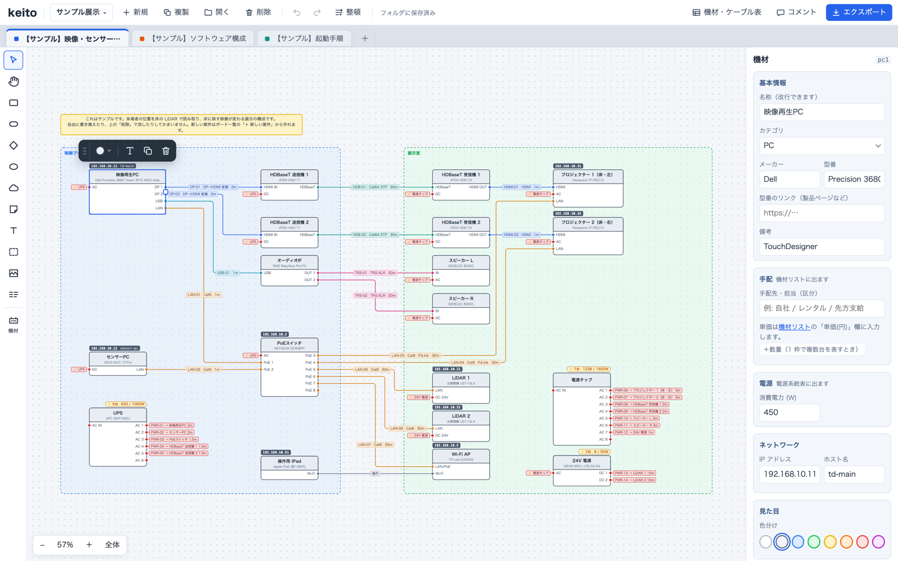
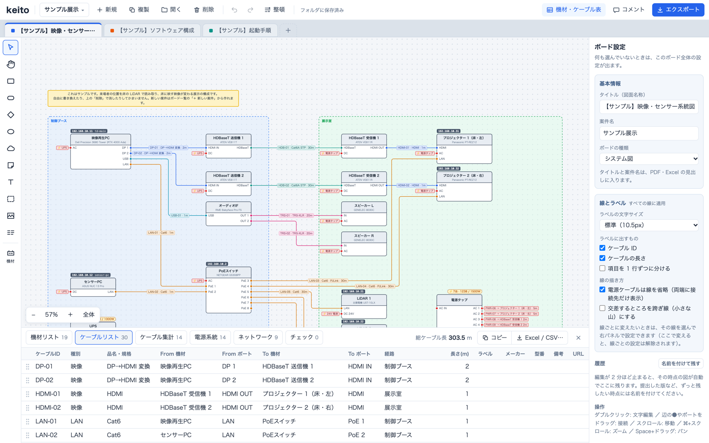
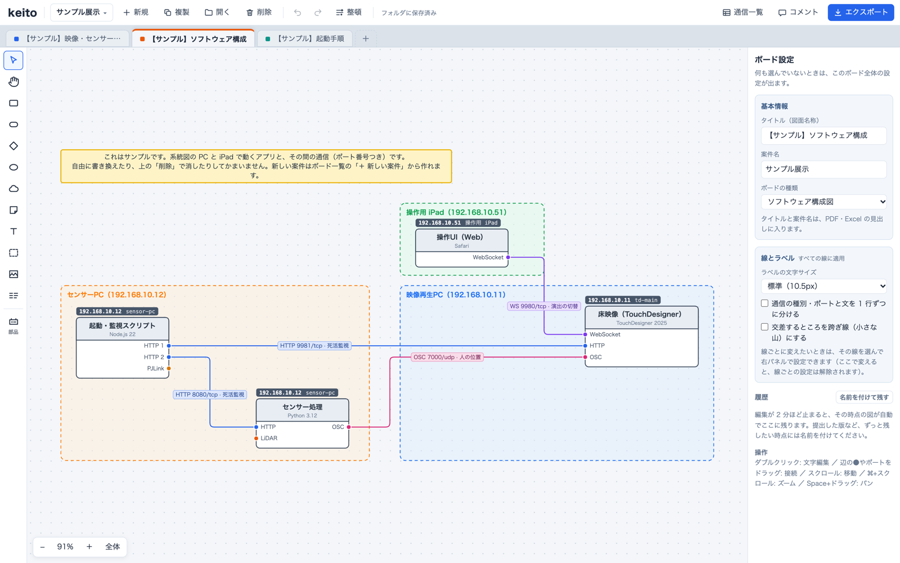
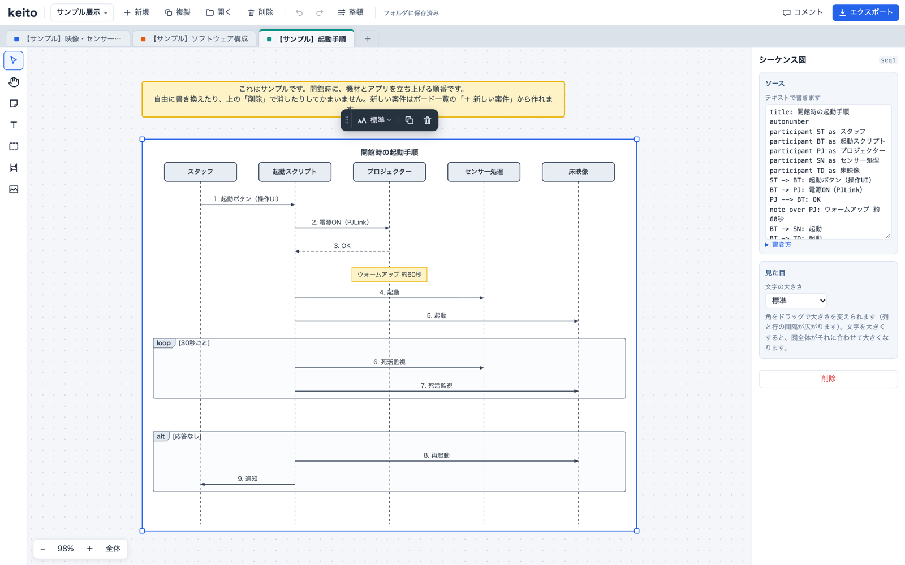
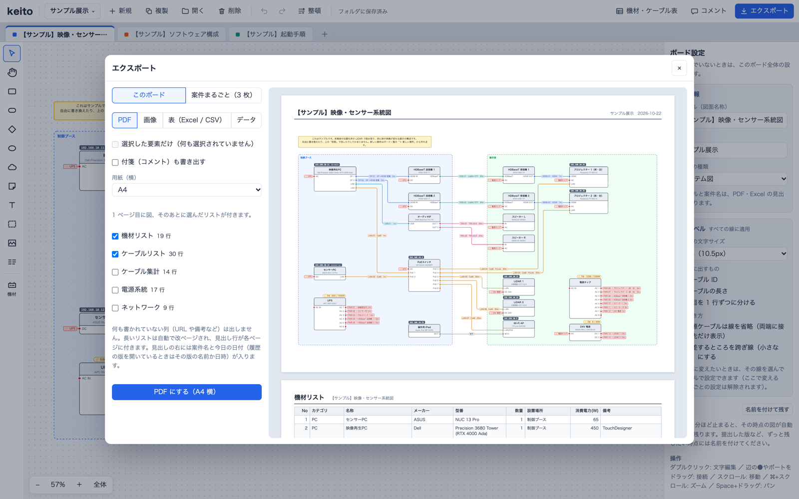

# keito

English | [日本語](README.md)

A diagramming tool for technical directors. Draw **system diagrams (equipment and cabling)**, **software architecture diagrams** and **sequence diagrams** for exhibitions and events, plus **free boards** for layouts and notes. Equipment lists and cable schedules are built from what you draw.

The user interface is in Japanese.



## Features

- **Lines route themselves**: drag from port to port and the line finds its way around the equipment, with a cable ID (`HDMI-01` and so on) given automatically. Move a device and its lines are re-routed as you drag.
- **One button tidies the drawing**: keeping the layout you made, Tidy moves devices to the heights where their lines run straight, evens out the margins of areas, and cuts down crossings and bends. ⌘Z undoes it.
- **Lists come from the drawing**: equipment list, cable list, cable totals, power, network and a checklist are generated from the diagram. Edits made in a list go back into the diagram. Export to Excel, and when you update last time's workbook, what you added on the Excel side (such as purchase status) is kept.
- **Power load at a glance**: a UPS or power strip shows how many devices are plugged in and their total wattage, turning red when over capacity.
- **Software communication in one table**: draw how applications talk, with protocol and port, and get a list of every connection — ready for a venue's firewall request.
- **Sequence diagrams as text**: Mermaid and PlantUML syntax can be pasted in as is.
- **Boards grouped by project**: a project's boards sit side by side in tabs. Link the same device across boards and a change to its name or IP reaches the others. A software component given a system-diagram device as its host takes that device's host name and IP.
- **History to go back to**: snapshots are kept automatically as you work. Name the version you handed in, and list everything changed since.
- **Built for Japanese input**: the Enter that confirms an IME conversion does not end editing, and typing with a shape selected starts editing it.
- **Your data stays with you**: boards are saved as JSON in a folder on your computer. They can also be read and written as YAML, so changes can be tracked in git.
- **Works with Claude Code**: ask "add another PC to this system diagram" and Claude Code edits the board from the command line.

## Screens

### Equipment and cable lists

The devices and cables in the diagram become lists. Click a row to select that device on the diagram.



### Software architecture diagram

Group applications and servers in areas, one for each computer they run on. Lines show the protocol and port.



### Sequence diagram

Write it as text in the right-hand panel and it becomes a diagram.



### Export

Export to PDF (A4 / A3 landscape), image (PNG / SVG), lists (Excel / CSV) and data (`.keito.json` with images embedded, or YAML). A PDF can hold the diagram and the lists together. Exporting a whole project puts each board's diagram and lists into one PDF, or each board's file into a ZIP for the other formats.



## Getting started

There are no prebuilt releases yet; run it from source.

### Requirements

- [Node.js](https://nodejs.org/) 22 or later
- [Rust](https://www.rust-lang.org/tools/install), only to build the desktop app (tested on macOS)

### In the browser

```bash
git clone https://github.com/genkitoyama/keito.git
cd keito
npm install
npm run dev
```

Open the URL shown in the terminal (usually http://localhost:5183, or another port if that one is taken). The first time, a sample project is created: a system diagram, a software architecture diagram and a sequence diagram.

Boards are saved in `keito/boards/`. To save them elsewhere, set the `KEITO_BOARDS` environment variable, or `"boards"` in `~/.config/keito/config.json`.

### As a desktop app

```bash
npm run app        # run in development mode
npm run app:build  # build the .app and .dmg (in src-tauri/target/release/bundle/)
```

On first launch, choose the folder for your boards (`Documents/keito`, or one you pick). Point it at the same folder as the command line or the browser version and they share the same boards.

## Command line and Claude Code

Boards can be read and written without opening the app. A board is named by its id, its folder name, or part of its title.

```bash
npm run keito -- boards                     # list the boards
npm run keito -- show 系統図 > board.yaml    # take a board out as YAML
npm run keito -- apply 系統図 board.yaml     # apply the edited YAML
npm run keito -- xlsx 系統図 --update 機材ケーブル表.xlsx   # update last time's Excel workbook
```

`npm run keito` on its own lists every command. The state before each write goes into the board's history, so it can be restored.

Instructions for Claude Code are in `.claude/skills/keito/`. Open Claude Code in the keito folder and ask in plain words to change a diagram. No API key is needed.

## Documentation (in Japanese)

- [User guide](docs/guide.md): every feature in detail, keyboard shortcuts, where things are saved, all command-line commands
- [Development guide](docs/development.md): source layout, tests, building a signed app

## Known limitations

- No real-time collaboration or cloud sharing: boards are saved on your own computer only. To hand one over, send an exported `.keito.json` or the board's folder.
- The desktop app has been tested on macOS only.

## License

[MIT](LICENSE)
